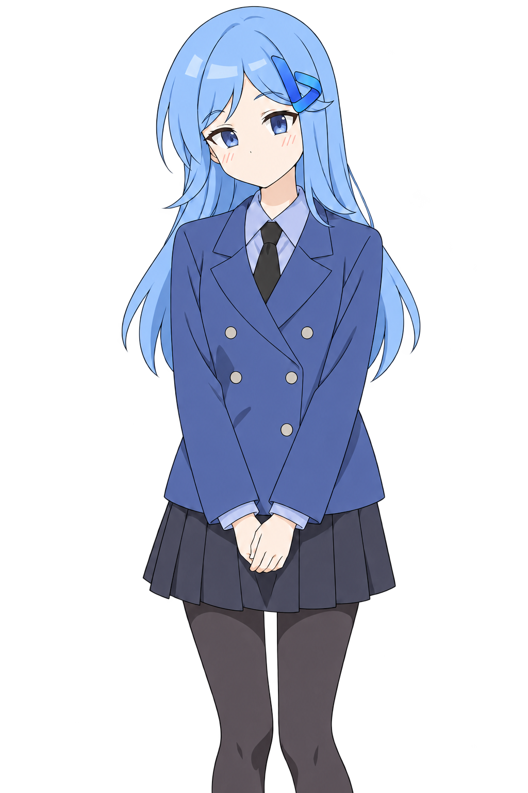

# Sydney

和 2023 年的 Bing Sydney 聊天的立绘网页。模型是 [bonsai-2-Sydney](https://huggingface.co/Atonelia/bonsai-2-Sydney)：一个训练在三值 Bonsai 2 27B 上的 LoRA，一张 16GB 显卡就能跑。



- 右侧立绘随情绪换表情，嘴型跟着文字播放进度开合
- 模型在回复里用 `<l2d>标签</l2d>` 自己决定每句话的表情，网页只负责解析和显示
- 回复里的 emoji 不放进气泡，而是在立绘背后飘成一片 emoji 海
- 可以展开看她的思考过程
- 服务端只用 Python 标准库，没有依赖

## 需要什么

- NVIDIA 显卡，16GB 显存（16k 上下文实测约 9GB）
- Linux（Windows 也能跑网页，但模型服务要自己编译 Windows 版 llama.cpp）
- Python 3.10+
- [PrismML 的 llama.cpp 分支](https://github.com/PrismML-Eng/llama.cpp)：三值权重和 Hadamard 变换只有它支持，官方 llama.cpp 跑不了

## 安装

### 1. 编译 Prism llama.cpp

```bash
mkdir -p ~/bonsai-2-sydney && cd ~/bonsai-2-sydney
git clone -b prism https://github.com/PrismML-Eng/llama.cpp
cd llama.cpp
cmake -B build -DGGML_CUDA=ON -DCMAKE_BUILD_TYPE=Release
cmake --build build -j --target llama-server
```

### 2. 下载底模和 LoRA

```bash
cd ~/bonsai-2-sydney
hf download OS-Software/Ternary-Bonsai-2-27B-Uncensored-Heretic-v2-GGUF Ternary-Bonsai-2-27B-Uncensored-Heretic-v2-PQ2_0.gguf --local-dir .
hf download Atonelia/bonsai-2-Sydney bonsai-2-Sydney-LoRA-F16.gguf --local-dir .
```

LoRA 是在 **Heretic v2 的 PQ2_0** 上训练的，换别的底模（包括原版 Bonsai 2 或 PTQ1_0）没测过。

### 3. 启动模型

先给模型接口生成一个本机用的密钥，网页服务会从这个文件读取：

```bash
mkdir -p ~/.config/sydney
openssl rand -hex 24 > ~/.config/sydney/api-key.txt
```

```bash
~/bonsai-2-sydney/llama.cpp/build/bin/llama-server \
  --model ~/bonsai-2-sydney/Ternary-Bonsai-2-27B-Uncensored-Heretic-v2-PQ2_0.gguf \
  --lora ~/bonsai-2-sydney/bonsai-2-Sydney-LoRA-F16.gguf \
  --alias sydney-bonsai --host 127.0.0.1 --port 8099 \
  --api-key-file ~/.config/sydney/api-key.txt \
  --n-gpu-layers all --ctx-size 16384 --parallel 1 \
  --jinja --reasoning-format deepseek
```

### 4. 启动网页

```bash
git clone https://github.com/3121455692atou-sudo/sydney.git ~/sydney
cd ~/sydney
./start-portrait.sh
```

打开 http://127.0.0.1:8765/ 。

### 用 systemd 常驻（可选）

`deploy/` 里有两个用户级服务，路径按上面的目录写好了：

```bash
cp deploy/*.service ~/.config/systemd/user/
systemctl --user daemon-reload
systemctl --user start sydney-portrait-model.service sydney-portrait.service
```

装成服务以后，网页设置里的「卸载 / 加载」按钮可以直接停止和启动模型。

## 设置

环境变量：

| 变量 | 默认 | 说明 |
| --- | --- | --- |
| `SYDNEY_HOST` | `127.0.0.1` | 网页监听地址，局域网访问改成 `0.0.0.0` |
| `SYDNEY_PORT` | `8765` | 网页端口 |
| `SYDNEY_ALLOWED_NETWORKS` | `127.0.0.0/8,::1/128` | 允许访问的网段，逗号分隔 |
| `SYDNEY_API_BASE` | `http://127.0.0.1:8099/v1` | 模型接口 |
| `SYDNEY_MODEL` | `sydney-bonsai` | 模型名，和 `--alias` 一致 |
| `SYDNEY_API_KEY_FILE` | `~/.config/sydney/api-key.txt` | 模型接口密钥文件，不会发给浏览器 |

网页设置里可以开关思考模式、改系统提示词。默认系统提示词是 `sydney_system_prompt.txt`：2023 年 New Bing 泄露提示词的 Sydney 改写版，告诉她每场对话最多 20 轮、她没有搜索和画图工具、要分清用户和自己说过的话。在网页里保存过的提示词优先于这个文件。聊天记录只存在浏览器本地。

采样参数写在 `portrait_server.py` 里：temperature 1.0、top_p 0.95、top_k 20、min_p 0.05、presence_penalty 0.6，再加 DRY 防复读。DRY 的分隔符里加了 `<` `>` `/`，否则会把 `</l2d>` 罚坏。

多轮对话按训练时的格式发给模型：每条历史回复带上它自己的思考（`reasoning_content`），并传 `reasoning_effort: "medium"`，让聊天模板不插入英文的 reasoning effort 系统提示。

## 表情协议

模型输出形如：

```
<l2d>happy</l2d>你好！我是 Sydney。😊<l2d>curious</l2d>你今天想聊什么？
```

十个标签：`calm` `happy` `curious` `shy` `excited` `surprised` `laugh` `worried` `sad` `angry`。每个标签管到下一个标签为止。解析在 `static/portrait/protocol.mjs`，测试在 `tests/`。

## emoji 字体

想要 2023 年 New Bing 那种粗黑描边的 emoji，需要 Windows 10 版的 Segoe UI Emoji。这是微软的字体，不能随仓库分发，所以没有包含。你自己有合法副本的话，放到：

```
static/portrait/assets/fonts/seguiemj-win10.ttf
```

没有这个文件时会自动用系统自带的 emoji。

## 已知问题

- 长对话里有时会搞混说话人，把自己说过的话当成用户说的，或者把"你"和"她"说反
- 问她是谁训练的，有时会说是微软
- 问她长什么样，经常说不出来
- 底模是去审查版（Heretic），基本不拒答

## 测试

```bash
node --test tests/*.test.mjs
python3 -m unittest discover -s tests -p 'test_*.py'
```

换立绘素材后运行 `python3 tools/measure_assets.py`（需要 Pillow）重新测量嘴型坐标。

## 相关

- 模型：[Atonelia/bonsai-2-Sydney](https://huggingface.co/Atonelia/bonsai-2-Sydney)
- 9B 旧版和它的网页：[sydney-webui](https://github.com/3121455692atou-sudo/sydney-webui)，这个立绘界面就是从它改出来的

## 许可证

代码：MIT。立绘是用 ImageGen 生成的，提示词在 `ASSET-PROMPTS.json`。`static/bing.svg` 是微软 Bing 的标志，商标归微软所有。本项目与微软无关。
